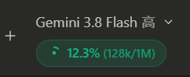
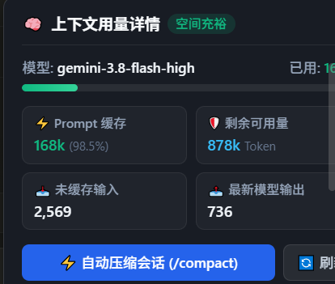

# Antigravity 上下文监控与一键压缩器 (Context Monitor)

<p align="center">
  
  
  
  
</p>

> 🎉 **VS Code 的 Antigravity 终于也有一键压缩与实时上下文监控了！**  
> 专为 Google Antigravity AI Agent 打造的上下文 Token 实时监视器与智能会话压缩插件，告别盲目对话与爆上下文卡顿。

---

## 📸 界面实测

### 1. 模型名称右侧 · 实时胶囊徽标
紧邻聊天输入框下方的模型选择器（如 `Gemini 3.8 Flash 高 ∨`）右侧，常驻精致的半透明电量胶囊，一眼洞悉当前上下文水位：
<p align="center">
  
</p>

### 2. 点击展开 · 沉浸式详情卡片与一键压缩
轻点胶囊徽标，在上方自动居中呼出暗色毛玻璃详情卡片，深度透视 Token 构成，并提供一键自动压缩：
<p align="center">
  
</p>

---

## ✨ 核心特性

- 🧠 **输入栏模型旁实时监控**：
  在输入框工具栏的模型选择器右侧同一行并排显示实时用量胶囊，包含动态环形进度仪表与 Token 统计（如 `🟢 12.3% (128k/1M)`）。
- ⚡ **一键自动智能压缩 (/compact)**：
  点击详情卡片中的 `⚡ 自动压缩会话 (/compact)` 按钮，程序自动将 `/compact` 注入输入框并触发发送，**一键全自动完成会话压缩，无需手动输入或粘贴**！
- 🔍 **核心指标深度透视**：
  - **⚡ Prompt 缓存命中率**：精确展示缓存复用率（如 `98.5%`），掌握秒级快速响应状态；
  - **🛡️ 剩余可用量**：直观展示离上限还剩多少可用额度（如 `878k Tokens`）；
  - **📥 未缓存直接输入**：本轮新增直接处理的原始 Token；
  - **📤 最新模型输出**：上一轮模型生成的回答 Token 数；
  - **📊 梯度动态进度条**：绿（充裕）/ 黄（偏高）/ 红（拥挤）三级色阶自动预警。
- 🛡️ **安全科普：压缩会不会丢失前文？**：
  - **绝对不会！** 压缩调用的是 Antigravity 官方底层的结构化状态提炼协议（Context Folding）；
  - **完整保留**：所有的用户核心需求、历史要求、修改指示、代码文件路径、生成过的工件与待办事项；
  - **精准剔除**：重复冗余的终端运行日志、重试报错输出等低价值数据。
- 🧭 **智能屏幕边缘检测**：
  弹窗采用固定视口自适应对齐，无论侧边栏拖动到多窄，弹窗均会自动向内贴附推回，两端始终保留 8px 舒适边距，**绝不歪出或超出屏幕**。
- 📌 **VS Code 底部状态栏双显**：
  保留 VS Code 最底部右下侧状态栏常驻项，点击支持打开底层 `transcript.jsonl` 日志及脑图存储目录。
- 🔒 **零侵入杜绝崩溃**：
  完全不破坏 Antigravity 核心 4.6MB 代码，采用轻量本地回环与异常安全吸收机制，确保 VS Code 稳定运行。

---

## 📦 安装与使用

### 方式一：下载 VSIX 一键安装（推荐）

1. 在 GitHub 本仓库右侧 **[Releases](../../releases/latest)** 中下载最新版本的 `antigravity-context-monitor-1.0.0.vsix`；
2. 打开 VS Code，按下快捷键 `Ctrl + Shift + X` 打开“扩展”面板；
3. 点击扩展面板右上角的 `···`（更多操作）菜单，选择 **“从 VSIX 安装...”**（Install from VSIX...），选中下载的文件即可完成安装；
4. 按 `Ctrl + Shift + P` 输入 `Developer: Reload Window`（重新加载窗口）刷新生效！

> 💡 **终端快速安装**：
> ```bash
> code --install-extension antigravity-context-monitor-1.0.0.vsix --force
> ```

### 方式二：从源码编译打包

```bash
git clone https://github.com/zhqin01/antigravity-context-monitor.git
cd antigravity-context-monitor
npx @vscode/vsce package --no-dependencies
code --install-extension antigravity-context-monitor-1.0.0.vsix --force
```

---

## ⚙️ 快捷指令与菜单

按 `Ctrl + Shift + P` 键入 `Antigravity` 即可唤出全部便捷指令：
- `Antigravity: 打开上下文管理菜单`
- `Antigravity: 刷新上下文用量`
- `Antigravity: 查看上下文详细指标`
- `Antigravity: 复制 /compact 压缩指令`
- `Antigravity: 打开对话日志`
- `Antigravity: 打开会话数据目录`

---

## 📄 开源许可证

本项目基于 [MIT License](LICENSE) 开源。
欢迎提出 Issue 与 Pull Request！喜欢的小伙伴欢迎点个 ⭐️ Star 支持一下！
